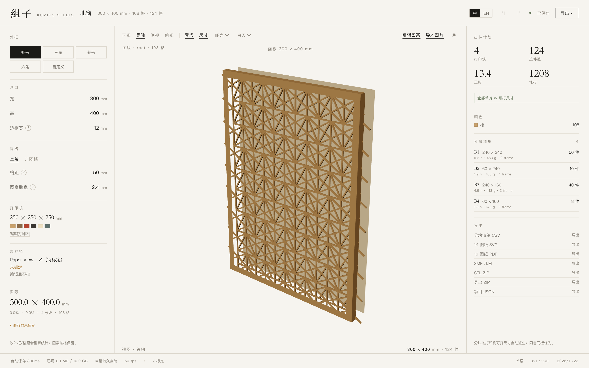
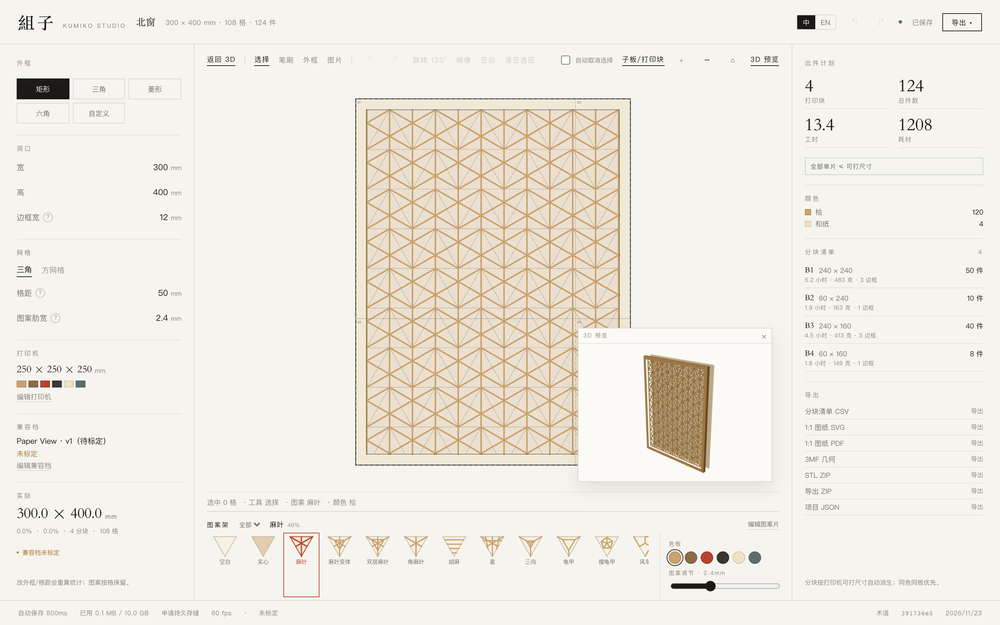

# Kumiko Studio

Single-page kumiko workbench for designing, previewing and exporting 3D-printable kumiko
panels. Chinese / English UI. Built from PRD v0.10 (the PRD is kept outside this repository).

单页组子工作台：从外框、网格、图案（手动/图片）到打印分块清单与导出，默认 3D、按需 2D，
界面中英双语。按 PRD v0.10 开发；PRD 不进入本仓库。




## Quick start / 快速开始

```bash
npm install
npm run dev        # http://127.0.0.1:5173
npm run build      # dist/ (includes Service Worker)
npm run preview    # production preview, offline-testable
```

Requirements: Node 20+, Chrome / Edge (latest two majors). This is a desktop-first app
(minimum 1280×800).

## What works / 已实现

- **Single page / 单页**: no tab bar; default 3D; `Edit pattern` / `Import image` switches only
  the center canvas to 2D; left config and right print plan stay live; 3D mini window in 2D.
- **Frames / 外框**: rectangle, triangle, diamond, hexagon (hex is also the coaster preset) and
  a custom polygon editor. Drag vertices, click an edge to add, Alt-click a vertex to delete.
  Inner offset, hanger placement and block lines are derived from the printer.
- **Triangle / square grids / 三角与方网格**: pitch, pattern rib, inner frame; cells clipped to
  the frame; partial edge cells.
- **Pattern designer / 图案设计器**: 18 triangular pieces + 8 square pieces, pattern shelf,
  selection (click / Shift / marquee / Alt / right-click clear), brush with continuous painting,
  rotate 60°/90° (120° for triangle), mirror, printer palettes, custom pattern piece editor
  (toggle ribs; one colour per insert).
- **Image to pattern / 图片转图案**: per-cell average colour/luminance → pattern density; CIEDE2000
  nearest printer colour; auto contrast; underlay; low-confidence marks; manual correction.
- **Printer / 打印机**: editable build volume (X/Y/Z), margin, nozzle, allowed filament colours;
  automatic block split; per-block parts/colours/hours/filament; fit check.
- **Exports / 导出**: block-list CSV (UTF-8 BOM), 1:1 drawing SVG and browser-print PDF (hanger
  coordinates included), 3MF geometry with colours, assembled STL, per-variant/frame/background
  parts ZIP, project JSON.
- **3D preview / 3D 预览**: three.js instanced geometry, backlight/materials/light presets,
  front/iso/side/top, 2× PNG screenshot, live mini 3D in 2D mode.
- **Bilingual / 中英双语**: top-bar `中 / EN`; persisted; UI, errors, terms, parameter popovers,
  pattern names, block list and exports; Japanese names remain in terms/popovers.
- **Local & offline / 本地与离线**: IndexedDB projects, 800 ms autosave, project library,
  trash/restore, JSON import/export, full backup, multi-tab conflict, Service Worker in production.
- **Terms & profile / 术语与兼容档**: searchable zh/ja/en terms and a compatibility-profile drawer
  with fit records and calibration marking.

## Architecture / 架构

```
src/
  App.jsx                 single-page shell, state, autosave, exports
  components/
    Preview3D.jsx         three.js panel, backlight, mini 3D
    PatternEditor2D.jsx   SVG triangle/square editor, selection, brush, frame vertices
    PatternShelf.jsx      pattern shelf, palettes, rib adjustment
    ImageImport.jsx       image → pattern modal
    Modals.jsx            printer, profile, terms, pattern piece, project library
  data/
    model.js              frame polygons, clipper offset/intersection, cells, blocks, plan
    patterns.js           canonical triangle/square pattern pieces
    image.js              cell rasterisation, CIEDE2000 palette match, density match
    export.js             1:1 SVG, CSV, STL, 3MF, parts ZIP
    store.js              IndexedDB + localStorage fallback
    i18n.js, terms.js     zh/en strings, terms, parameter metadata
```

Stack: React 19, Vite 8, three.js 0.187, fflate, clipper-lib. Geometry and image conversion run
in the browser; there is no backend, no telemetry.

## Verified / 已验证

- Playwright checks: 3D/2D modes, selection + brush, pattern piece editor, custom frame
  drag/add/delete, image conversion, printer bed change, profile calibration, JSON import,
  backup, 1:1/3MF/STL/CSV/parts ZIP exports, 3D screenshot, offline reload.
- Export validation: 3MF XML well-formed (objects, vertices, triangles, colours); binary STL
  triangle count; parts ZIP entries; CSV BOM and rows; 1:1 SVG with dimensions and hangers.
- No console/page errors in the checked flows.

## Known gaps vs PRD v0.10 / 与 v0.10 的差距

This is a working **MVP**, not the full 10-week scope. Honest gaps:

1. **Custom frame printing**: the 3D frame ring and inner backing follow the custom outline, but
   the printable border is exported as straight frame segments and axis-aligned blocks. A full
   per-edge mitered 3D border, block-clipped subpanels and dovetail joints are not yet modelled.
2. **Print parts**: parts ZIP contains one STL per variant/frame segment/background/subpanel at
   the origin; the block list and CSV carry quantities/colours. Automatic per-bed nesting by
   block/colour is not implemented (arrange in the slicer). The assembled 3MF/STL is for
   inspection, not direct printing of the whole panel.
3. **Image → pattern**: density/colour matching only; no contour/line-art vectorisation and no
   automatic tracing. The underlay is not persisted with the project (re-import after reload).
4. **Patterns**: 18 triangular + 8 square starter pieces; no freehand motif drawing or
   transcription workflow; no multi-colour per insert (one filament colour per insert).
5. **Compatibility**: profile fields/fit/calibration are editable, but the `paperview-v1` values
   are placeholders, and dovetails/seam/groove are not in the exported parts. No STL slicing or
   XOR section comparison yet.
6. **Exports**: 1:1 PDF uses the browser print dialog; no 3MF engineering template, no STEP,
   no automatic per-block bed layout.
7. **Accounts/share**: intentionally absent (self-use, local-only).

## Data / 数据

Projects live in IndexedDB (`kumiko-studio`; localStorage fallback). Project JSON contains
frame/grid/paint/printer/custom patterns; the source image underlay is not stored. The production
build registers a Service Worker and works offline after the first load.

## Design / 设计

Direction: **01 逆光纸窗** — near-white paper, ink, one vermilion accent, Songti for display
and numbers, PingFang/system sans for UI, hairlines instead of cards, the panel as the hero.
Wireframes and interaction rules are in PRD v0.10 §5 (kept outside the repo).

## PRD

The PRD is intentionally **not** in this repository. It lives next to the project folder as
`../PRD-Kumiko-Studio-v0.10.md`.

## License

Personal project. No license is granted for redistribution; Paper View measurements and
traditional pattern names are used only as references.
